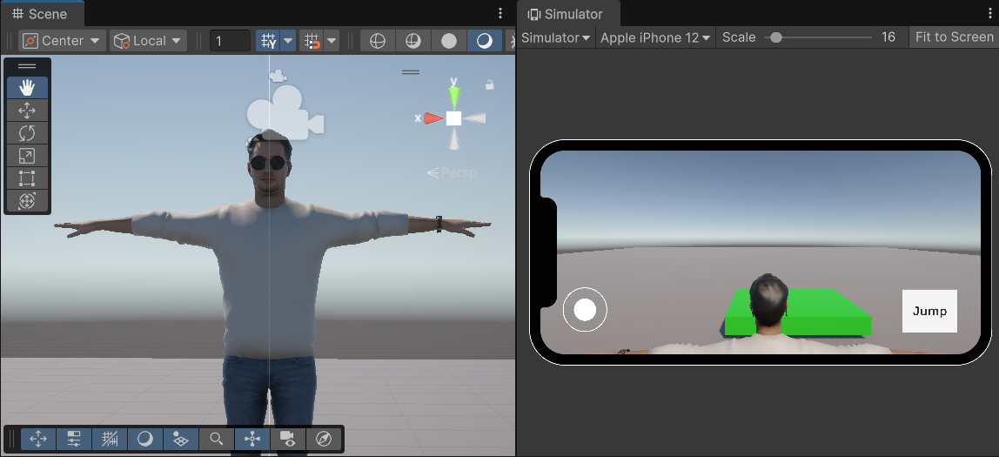
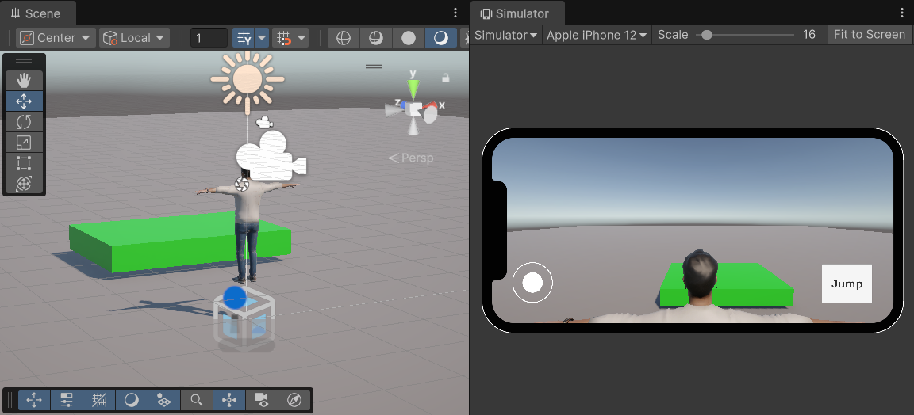
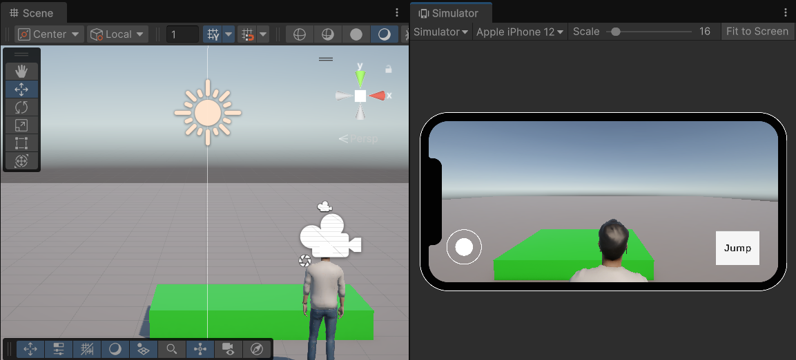
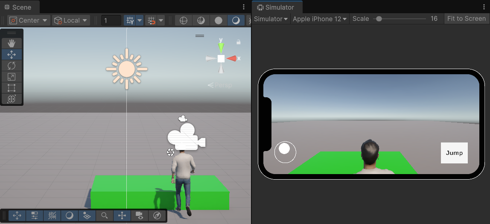
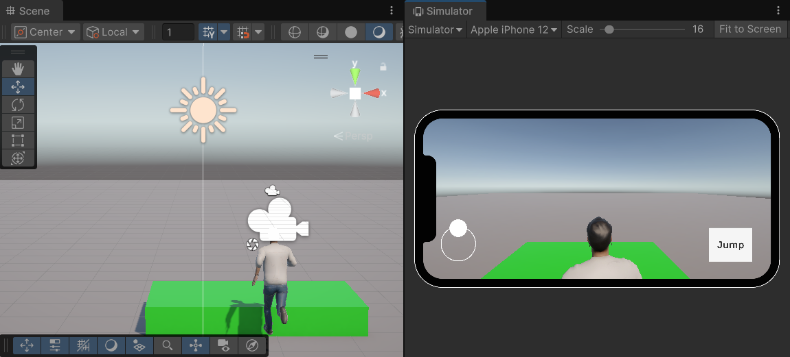
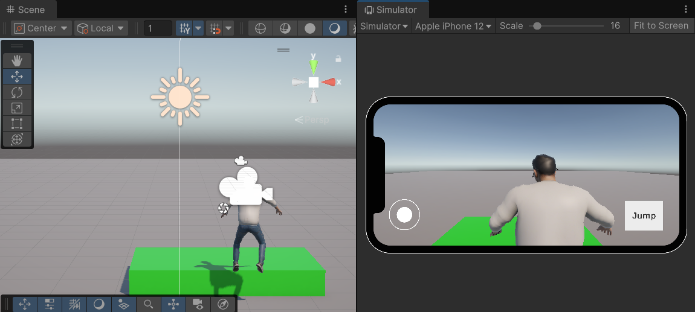

# Character Movement and Animation

## Character Creation and Animations

The character was created using **Anything World** and **Mixamo**. The following animations were added to the character:

- Idle
- Walking
- Running
- Jumping

## Controls and Animations

### Character

### Idle Animation

The character remains idle when no input is provided.

### Walking Animation

To make the character walk, slightly move the on-screen joystick.

### Running Animation

To make the character run, move the joystick all the way to its maximum position.

### Jump Animation

To make the character jump, simply press the **Jump** button.

## To-Do List

- [ ] Add a return animation to the character.
- [ ] Add lying down and crouching animations.
- [ ] Implement weapon handling and shooting simulations.
- [ ] Implement object interaction simulations.
