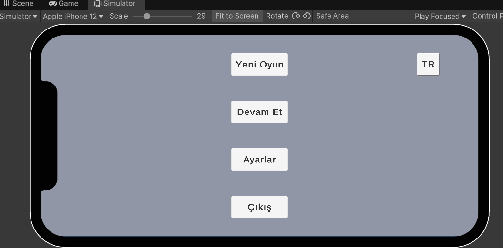
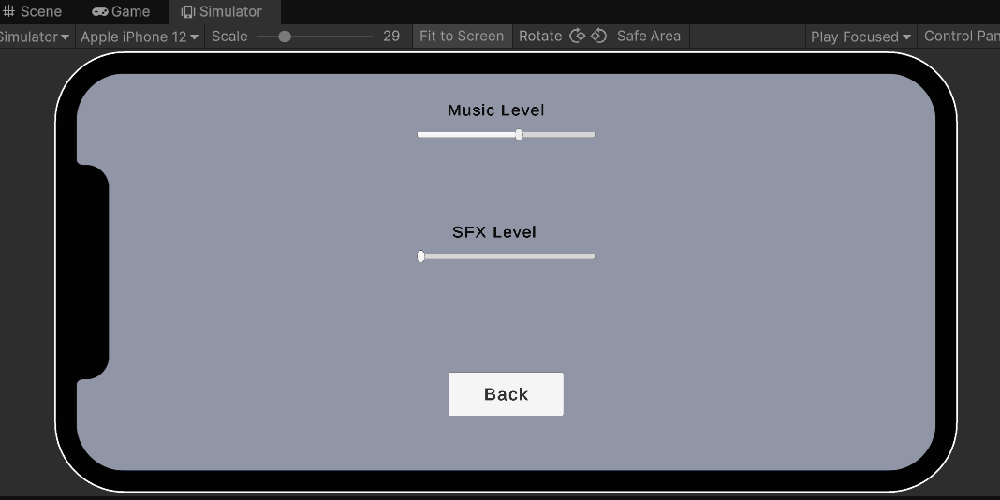
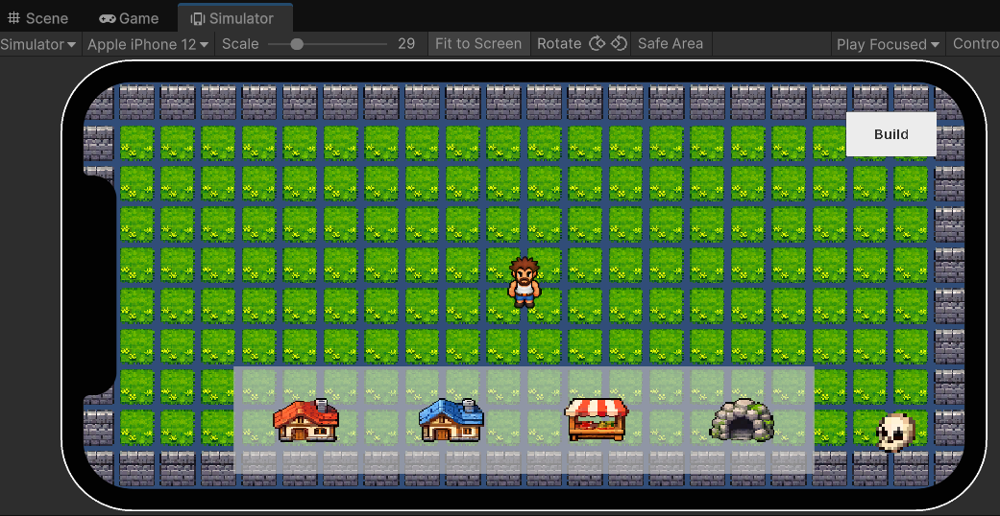
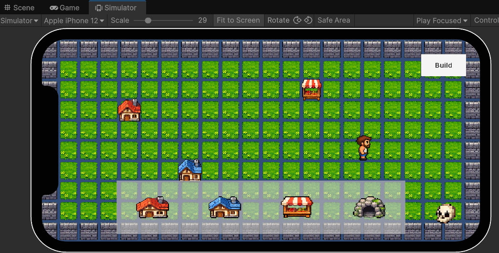

# 2D City Building Game

A 2D game development project focused on building and expanding a city. The initial screen and first level have been implemented, including basic gameplay mechanics, sound effects, character animations, and user settings.

## Main Menu

When the game starts, players are greeted with the main menu. The menu provides the following options:

- **Language Selection:** Players can choose between English and Turkish.
- **New Game:** Start a new game.
- **Continue:** Resume the previous game if saved game data is available.

  
  

## Settings

The settings menu allows players to customize their audio experience:

- **Background Music Volume:** Adjust the background music level.
- **SFX Volume:** Adjust the volume of sound effects and auxiliary sounds.

## City Building

The main objective of the game is to build and develop a city. Currently, four different building types are available for players to construct.

## Building Interactions and Sound Effects

Each constructed building has its own sound effect, providing audio feedback during gameplay.

Players can also interact with existing buildings by clicking or tapping on them. This feature can be enabled or disabled using the **skull button**.

  
  

## Character Animations

Character movement animations have been implemented to make the gameplay more dynamic and visually engaging.

## Future Improvements / To-Do

The following features are planned for future development:

- [ ] Add new levels to expand the gameplay experience.
- [ ] Improve character pathfinding so that the character can navigate toward clicked or tapped destinations while avoiding obstacles more effectively.
- [ ] Introduce enemies into the game.
- [ ] Implement shooting mechanics and defensive gameplay features.
- C#
- 2D Game Development
