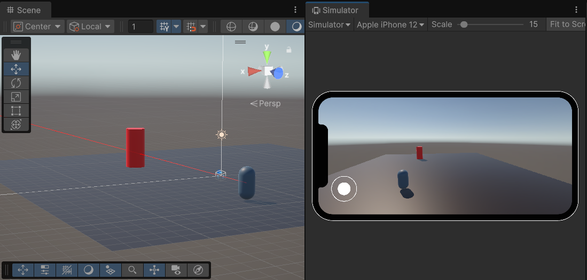

# Unity Game & Application Development Projects

This repository showcases various Unity game and application development projects, demonstrating different gameplay mechanics, character systems, raycasting techniques, and animation implementations.

## Projects

### 1. Raycasting & Character Damage System

This project demonstrates a basic character control and damage system using Unity.

**Features:**
- Character movement controlled via an on-screen joystick.
- Raycasting implementation to detect objects in front of the character.
- Applying damage to the detected target using raycast interactions.
- Basic interaction between the player character and other objects.

**Preview:**

---

### 2. Character Animation System

This project focuses on creating character animations from a T-Pose reference model using free animation tools and integrating them into Unity.

**Features:**
- Converting a static T-Pose character model into an animated character.
- Creating various character animations for in-game use.
- Preparing animations for different character movements and actions.
- Integrating character animations into a Unity project.

**Preview:**

---

## Technologies & Tools

- Unity 6.0
- C#
- Joystick Controls
- Raycasting
- 3D Character Animation
- Animation Integration

## License

This repository is licensed under the Apache License 2.0. See the `LICENSE` file for more information.
