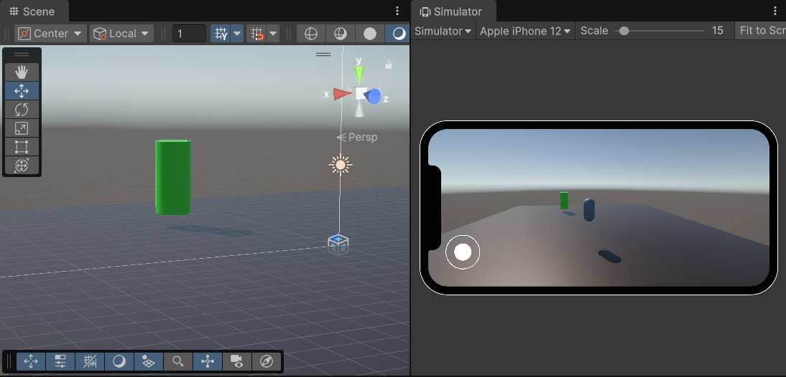
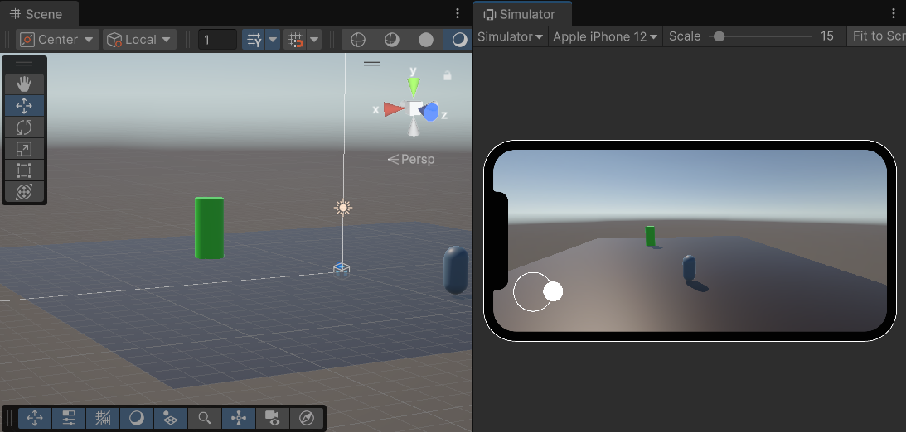
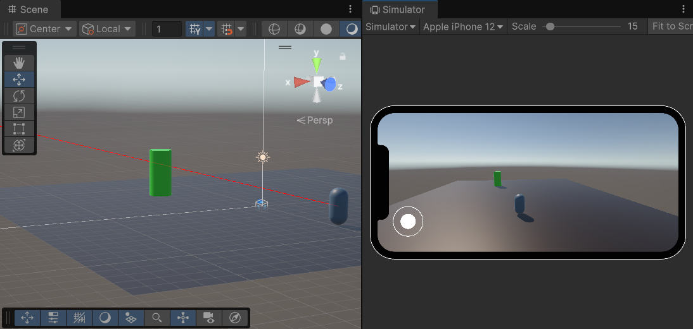
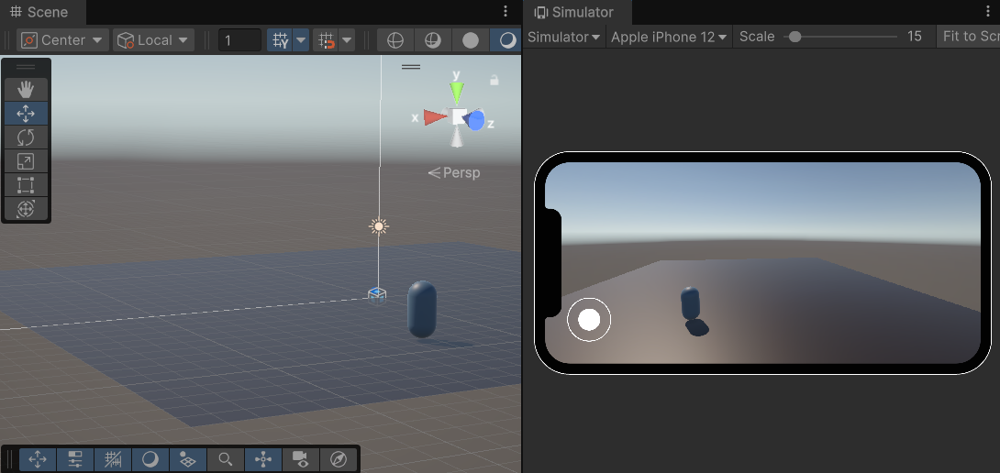

## Gameplay Overview

The game consists of a single scene.

### 1. Game Scene
The game takes place in a single scene.

### 2. Initial Setup
When the game starts, all characters and objects are positioned on the ground.

### 3. Character Movement
The player controls the character using the on-screen joystick.

### 4. Shooting Mechanism
The player can shoot at other characters or objects by pressing the right mouse button.

### 5. Health System & Game Over
When a character runs out of health, it is removed from the scene and the game ends.

